

# LingoFantasy

### 让每一个单词，都真正留在记忆里。

**See it. Hear it. Remember it.**

[简体中文](README.md) · [English](README_EN.md) · [官方网站](https://www.lingofantasy.com/) · [下载](https://www.lingofantasy.com/download.html)

---

## 让语言学习更贴近自己

认识一个单词，不只是记住它的拼写。真正掌握词汇，还需要听懂发音、理解含义、在语境中认识它，并在需要时主动回忆。

LingoFantasy 将词汇学习、听力、听写、笔记与复习整合到一个灵活的学习空间。你可以创建自己的学习内容，按照自己的节奏练习，让每一次学习都更有意义。

## 0 · 产品概览

LingoFantasy 是一款以个性化词汇学习为核心的语言学习应用，结合图像记忆、听力听写、语境理解、词库管理与学习进度追踪。

**Website:** https://www.lingofantasy.com/

### 产品界面预览

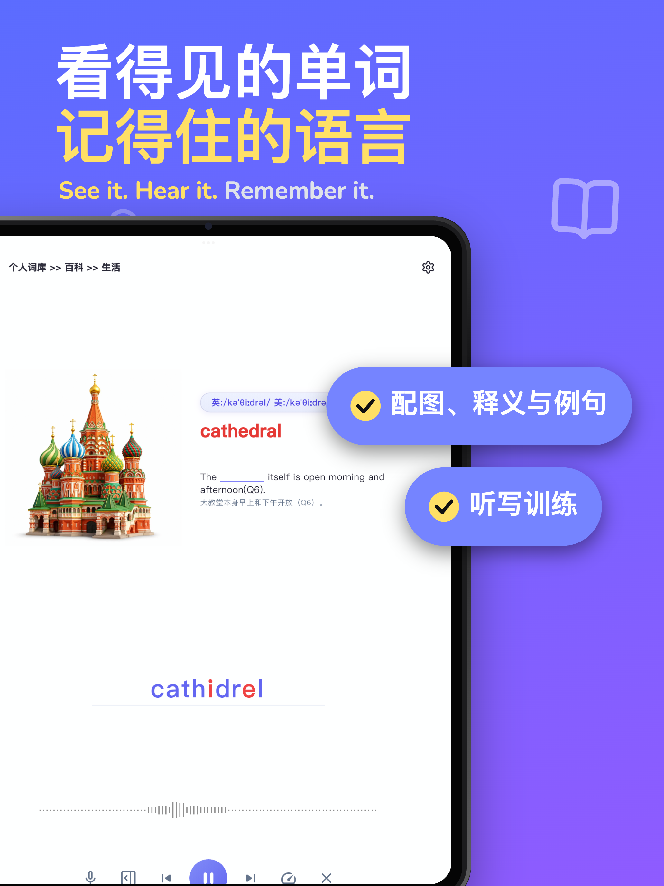

## 核心功能

### 1 · 视觉词汇记忆

将单词、图片、发音、释义和例句放在同一个学习流程中，让词汇不再只是需要背诵的文字。你可以结合视觉线索理解含义，再通过听觉和主动回忆巩固记忆。

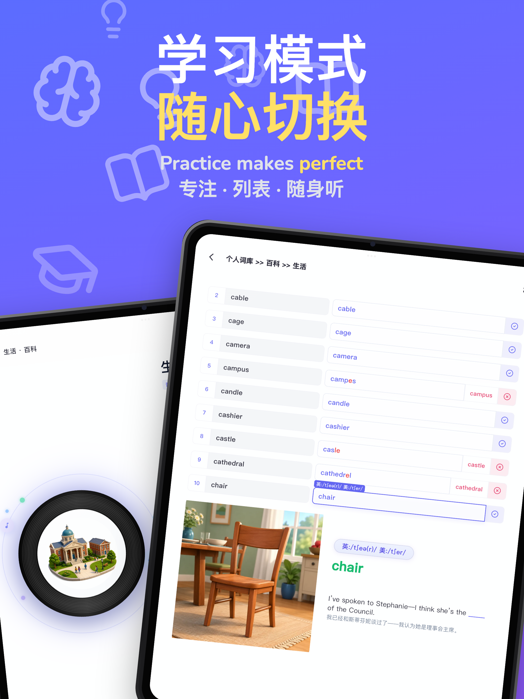

### 2 · 多种学习模式

根据学习目标选择词汇浏览、听力、精听或听写。可以专注理解，也可以隐藏提示，通过输入答案检验掌握程度。

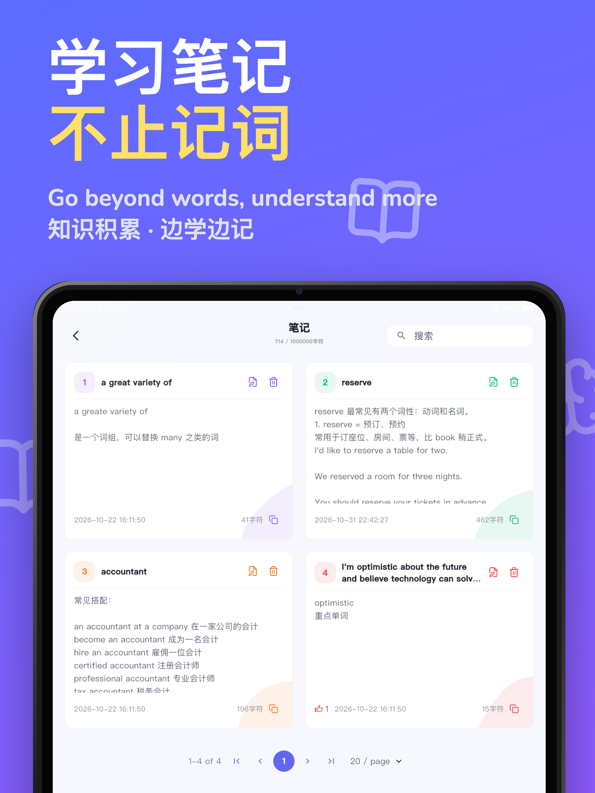

### 3 · 个人词库与章节

建立自己的词库，按照章节和小节整理词条，按学习主题维护内容。支持整理、导入与编辑学习材料，让词库随学习需求成长。

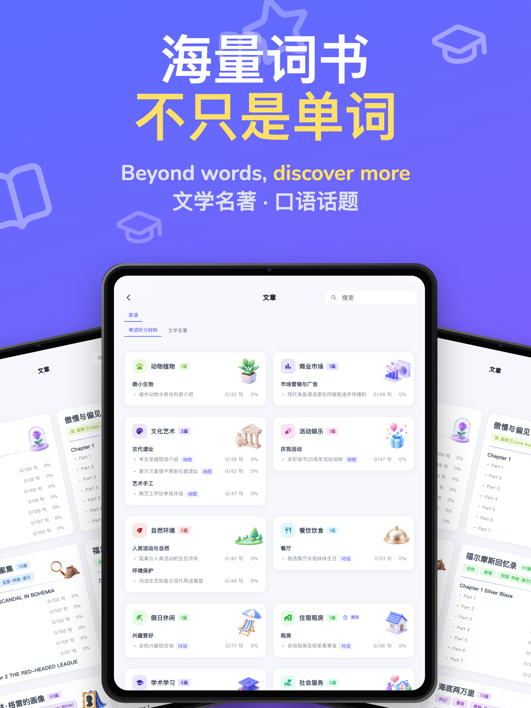

### 4 · 语境、例句与笔记

结合例句、文章和学习笔记理解单词的实际用法，将词汇记忆延伸到真实语境。

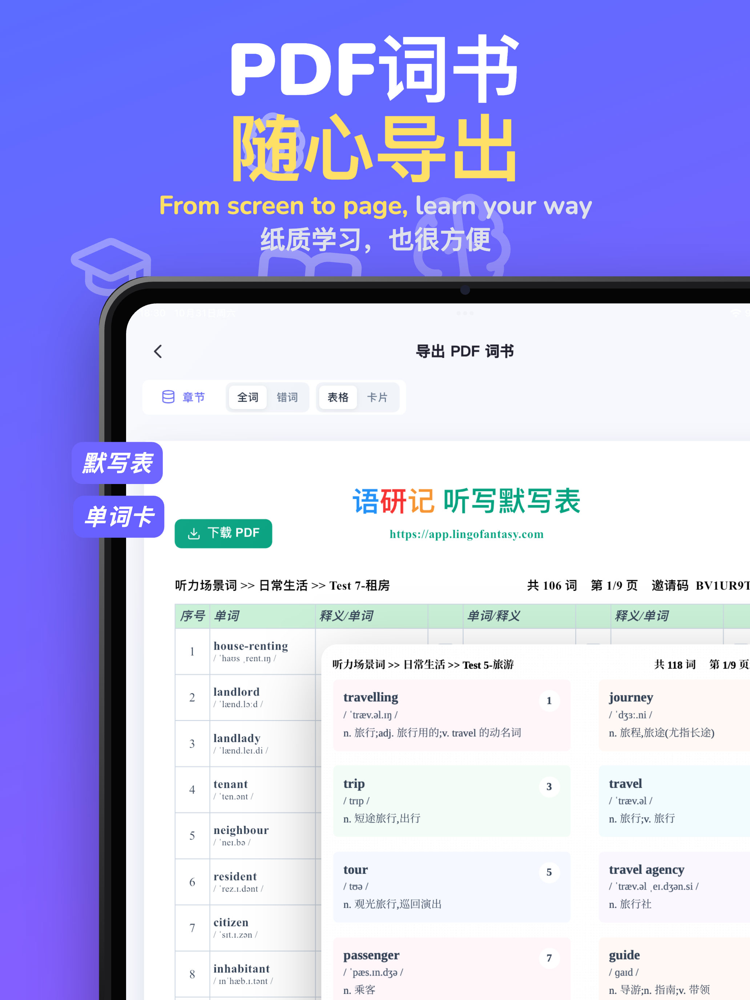

### 5 · 听力、精听与听写

通过音频播放和听写输入训练辨音与拼写能力。灵活调整练习方式与播放节奏，针对薄弱词汇重复练习。

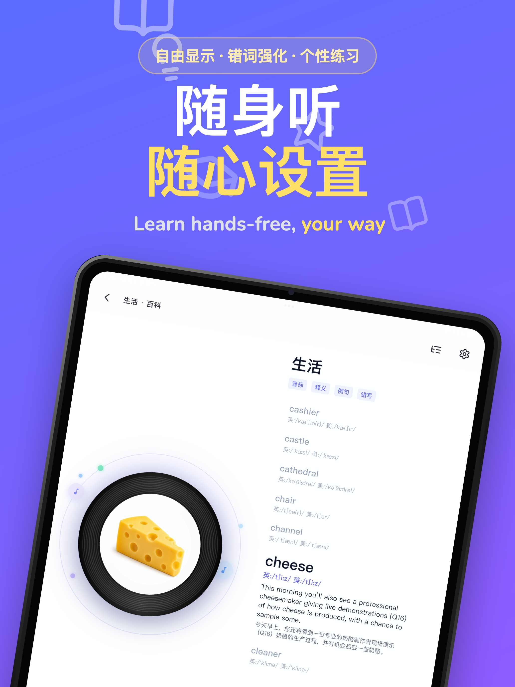

### 6 · 复习与学习进度

通过练习记录、错误词汇和学习统计了解进展，安排更有针对性的复习。

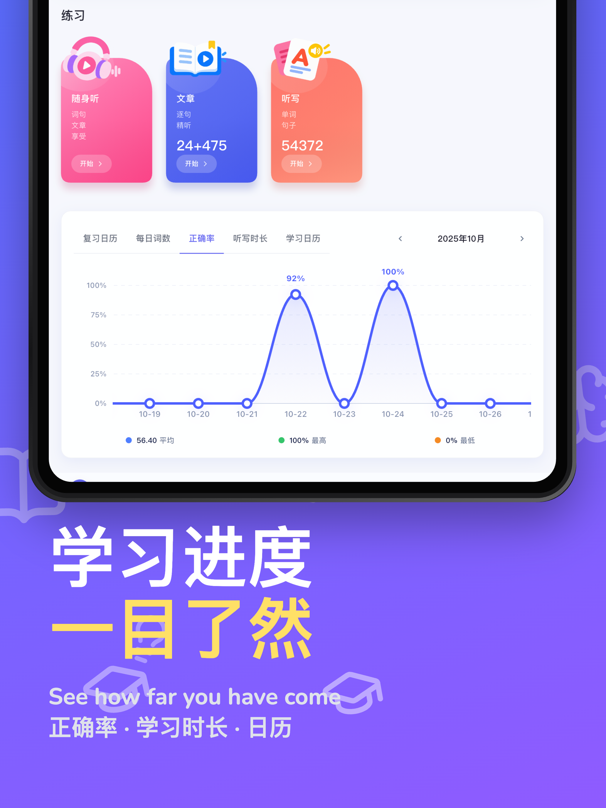

### 7 · 导出与自主学习

将学习内容导出为 PDF 等适合打印或分享的资料，让复习不局限于应用界面。

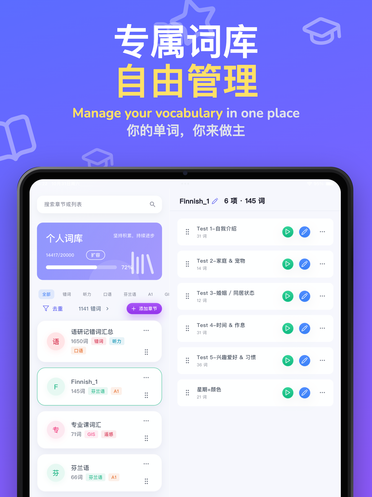

## 手机端体验

以下展示部分手机端产品界面。

  
  &nbsp;&nbsp;&nbsp;&nbsp;
  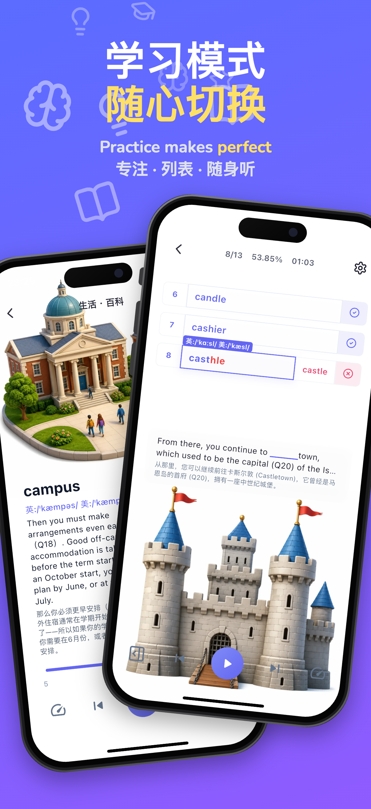
  &nbsp;&nbsp;&nbsp;&nbsp;
  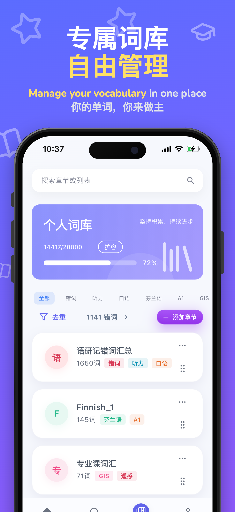

  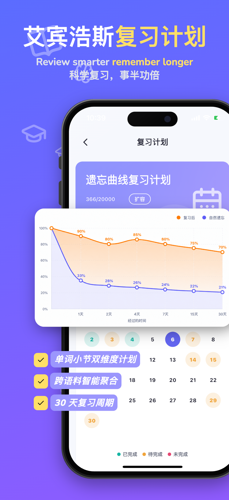
  &nbsp;&nbsp;&nbsp;&nbsp;
  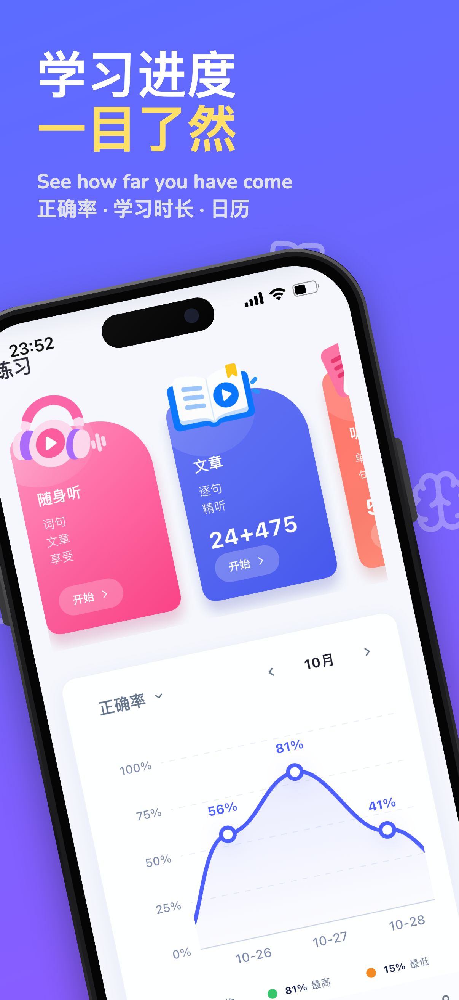
  &nbsp;&nbsp;&nbsp;&nbsp;
  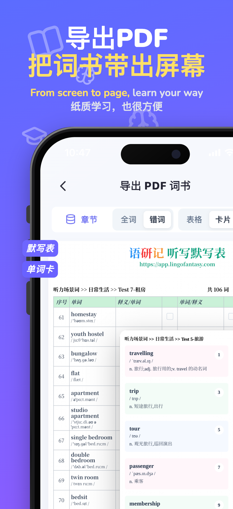

## 关于本仓库

本仓库用于展示 LingoFantasy 的产品理念与功能。公开展示仓库并不代表应用源代码已经开源；产品详情与可用版本请以官方网站为准。

## 开始了解 LingoFantasy

[访问 LingoFantasy 官方网站](https://www.lingofantasy.com/)

---

**LingoFantasy — See it. Hear it. Remember it.**

[简体中文](README.md) · [English](README_EN.md) · [lingofantasy.com](https://www.lingofantasy.com/)

