

# LingoFantasy

### Make every word stay with you.

**See it. Hear it. Remember it.**

[简体中文](README.md) · [English](README_EN.md) · [Official Website](https://www.lingofantasy.com/) · [Features](https://www.lingofantasy.com/#features)

---

## A more personal way to learn languages

Learning a word is more than recognizing its spelling. It means hearing its sound, understanding its meaning, meeting it in context, and being able to recall it when needed.

LingoFantasy brings vocabulary, listening, dictation, notes, and review together in a flexible learning experience. Create your own learning materials, practice at your own pace, and make each word part of what you truly know.

## 0 · Overview

LingoFantasy is a language-learning application centered on personalized vocabulary practice. It combines visual memory, listening, dictation, contextual learning, vocabulary management, and progress tracking.

**Website:** https://www.lingofantasy.com/

### Product preview

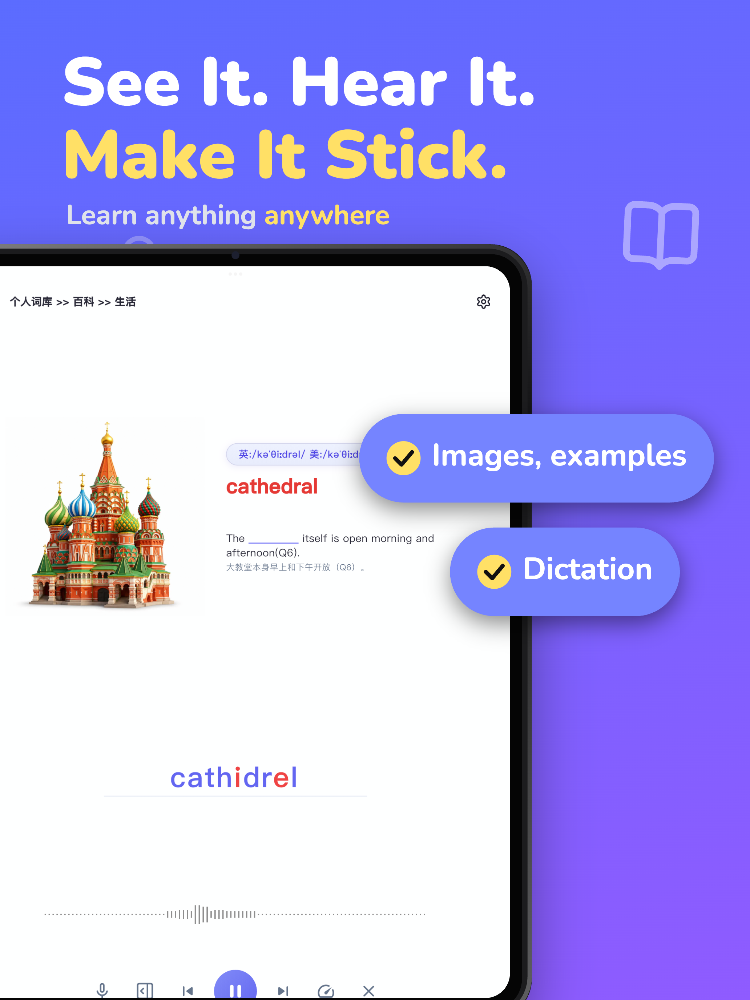

## Features

### 1 · Visual Vocabulary Learning

Bring vocabulary, images, pronunciation, definitions, and example sentences into one learning flow. Build stronger associations through visual context, listening, and active recall.

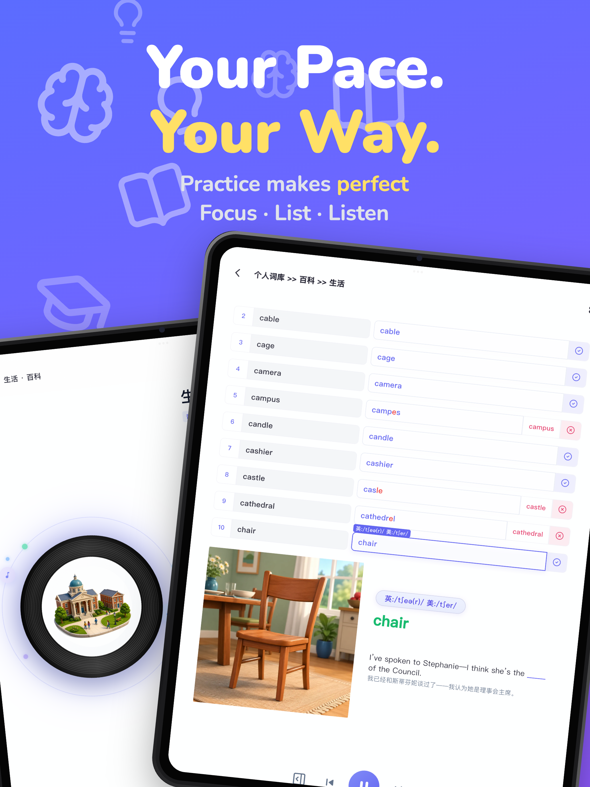

### 2 · Flexible Study Modes

Switch between vocabulary review, listening, intensive listening, and dictation. Learn with guidance or hide hints and test your recall by typing answers.

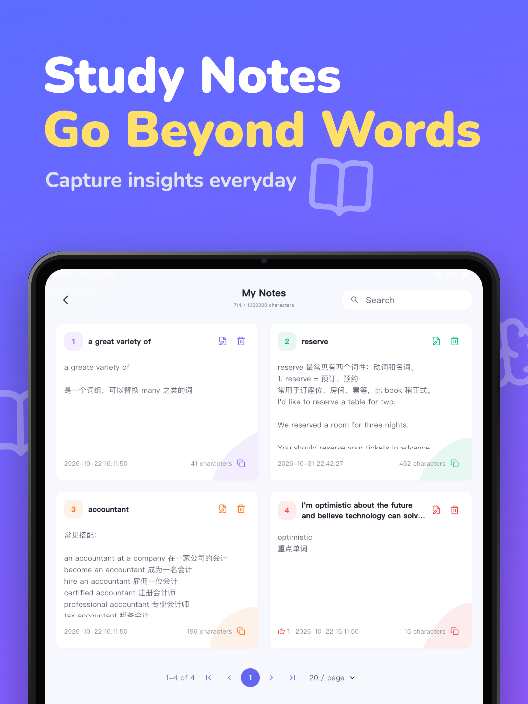

### 3 · Personal Vocabulary Library

Build your own vocabulary library and organize words into books, chapters, and sections. Import, edit, and curate materials around your own learning goals.

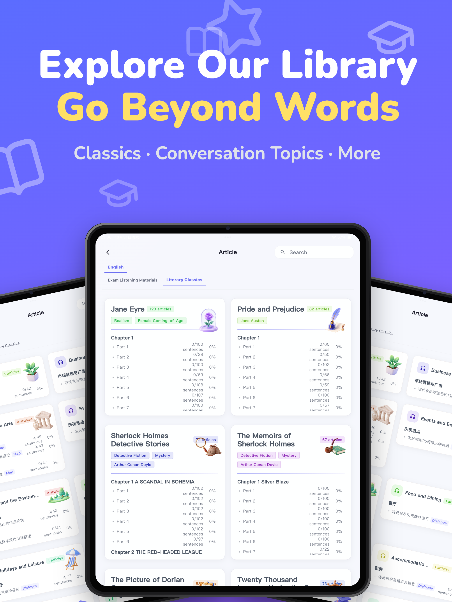

### 4 · Context, Examples & Notes

Explore usage through examples, reading materials, and personal notes. Move beyond isolated memorization toward understanding words in context.

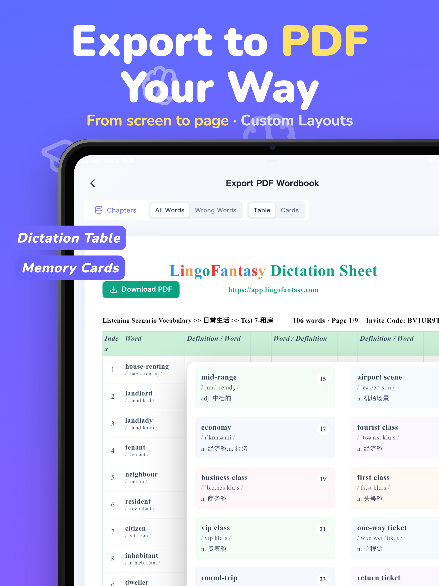

### 5 · Listening & Dictation

Practice sound recognition and spelling with audio playback and dictation. Adjust your learning pace and revisit difficult words.

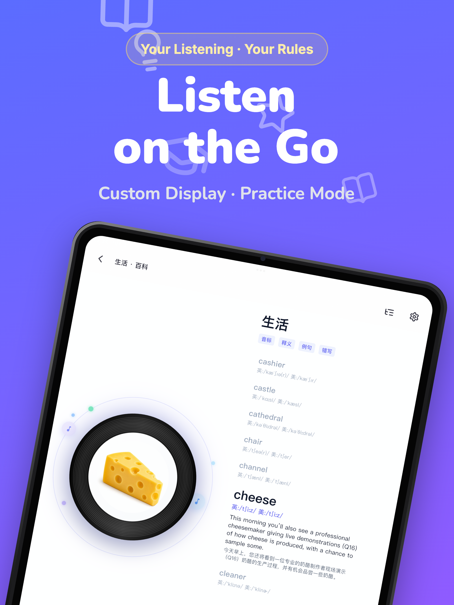

### 6 · Review & Learning Progress

Track practice history, mistakes, and learning progress to make each review session more focused.

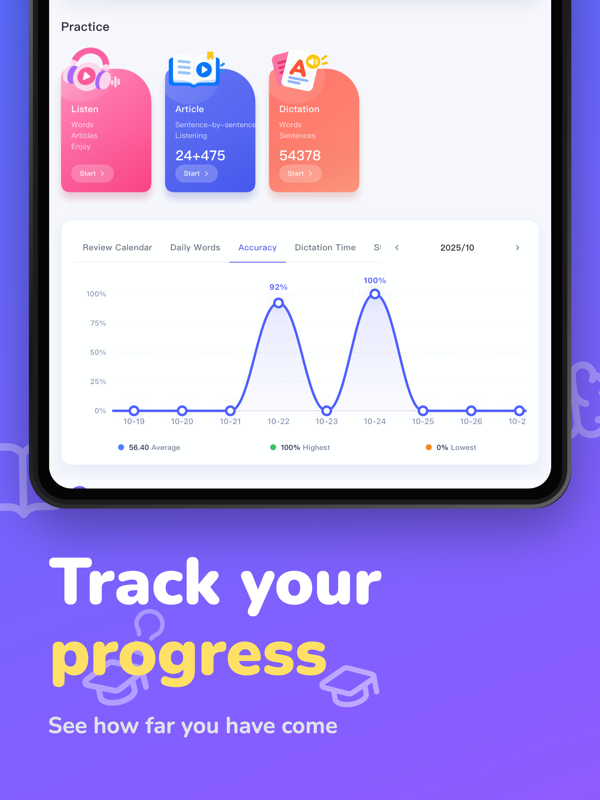

### 7 · Export & Study Anywhere

Export study materials, including PDF resources suitable for printing and offline review, so learning can continue beyond the app.

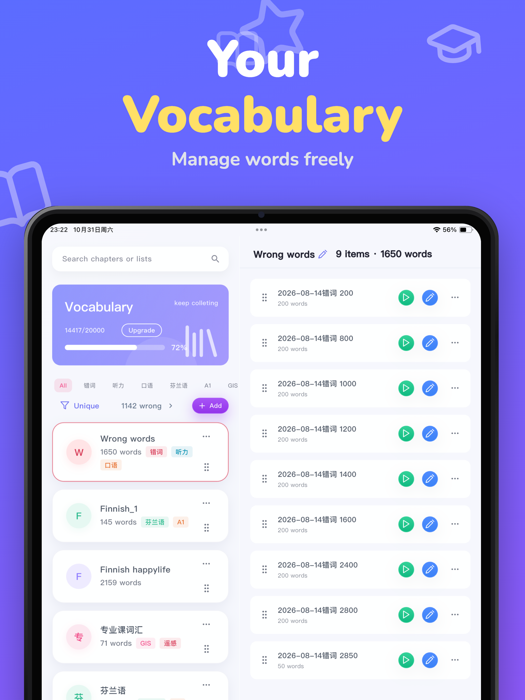

## Mobile experience

A selection of mobile screens from the product.

<table><tr>
<td align="center">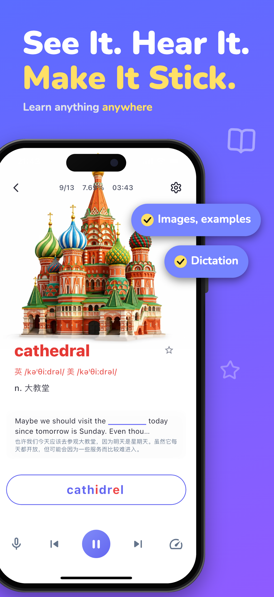</td>
<td align="center">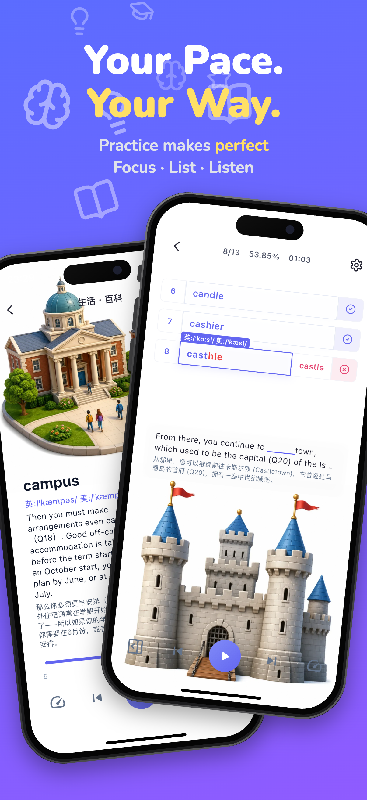</td>
<td align="center">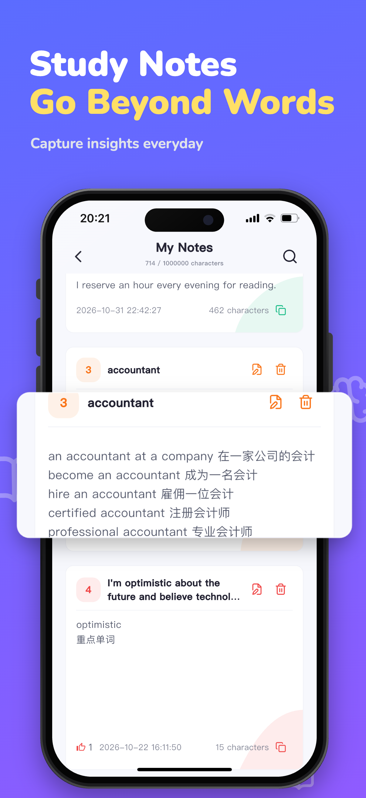</td>
</tr><tr>
<td align="center">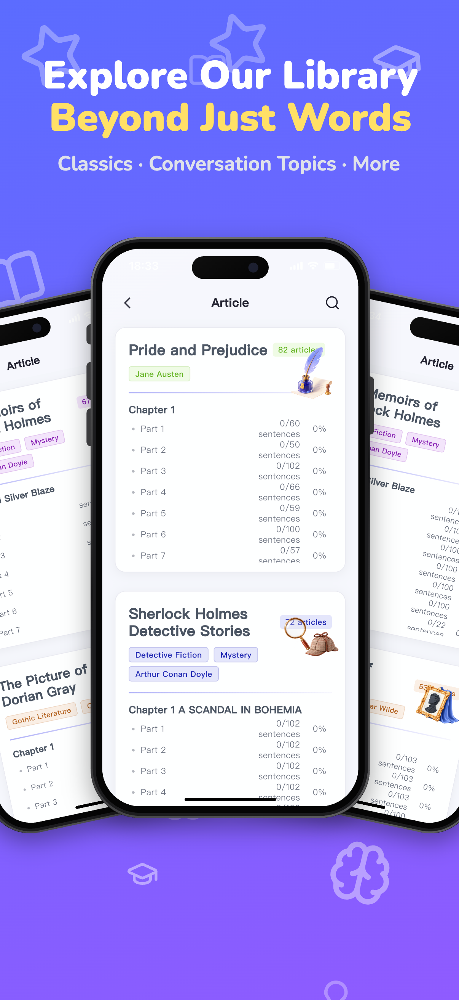</td>
<td align="center">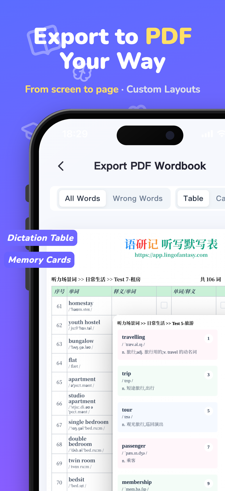</td>
<td align="center">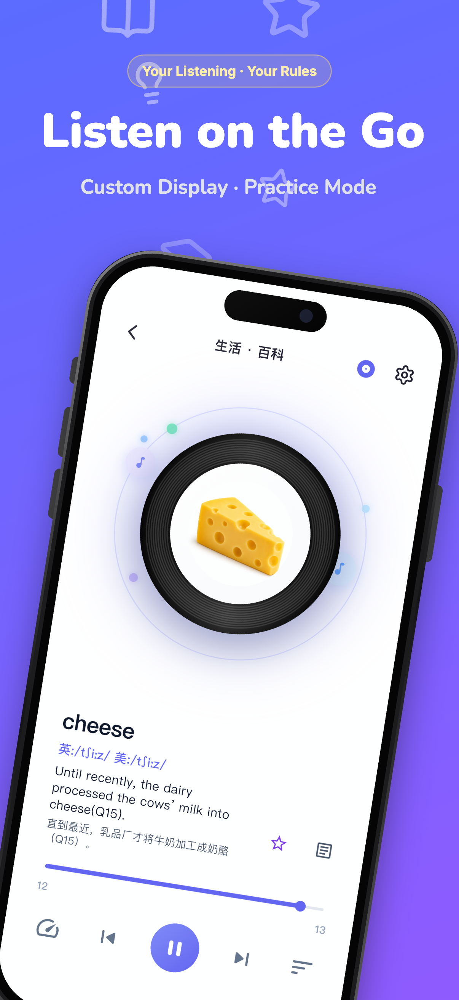</td>
</tr></table>

## About this repository

This repository introduces LingoFantasy and its product experience. The presence of a public repository does not by itself mean the application source code is open-source. For product details and availability, please visit the official website.

## Get started

[Visit the official website](https://www.lingofantasy.com/)

---

**LingoFantasy — See it. Hear it. Remember it.**

[简体中文](README.md) · [English](README_EN.md) · [lingofantasy.com](https://www.lingofantasy.com/)

